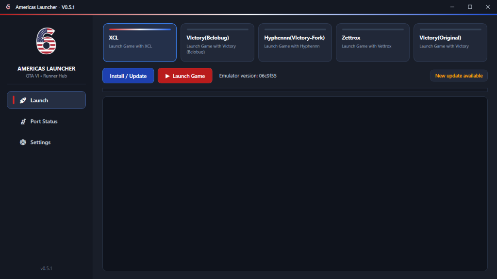

# Americas Launcher

A modern Windows 720p launcher that automatically sets up, updates, builds, and launches Xbox Series X|S (GDK) compatibility layers on Windows — with live port progress tracking built in.

> This project is intended **only for games you legally own**, unpacked on your own PC. Americas Launcher does **not** include, download, or distribute games, keys, or console SDK files.



## Features

- **Modern 720p UI:** Clean dark navy & patriot-themed interface with custom window controls and 5 selectable runner cards.
- **One-Click Install / Update:**
  - Automatically checks and installs missing dependencies via `winget` (Git, Visual Studio C++ Build Tools, Rust).
  - Clones and updates each runner's source repository with `git`, then compiles it locally.
  - Displays the installed commit hash and checks upstream for updates.
- **Integrated Console Output:** Runner output and pre-launch shader/pipeline translation logs stream directly inside the launcher's log box — no separate CMD window pops up.
- **Pre-Launch Pipeline Support:** Runs `preLaunchArgs` (such as `translate --pipelines`) sequentially before starting the game, with a clear notice when first-time translation may take several minutes.
- **Settings & Self-Update Check:** Configure your Game Folder and Game Exe paths, and check GitHub Releases for newer versions of Americas Launcher.
- **Live Port Status:** Built-in tracker powered by [Portwatch VI](https://portwatch-vi.xyz/).

## Supported Runners

Runners are configured in [`src/AmericasLauncher/Data/runners.json`](src/AmericasLauncher/Data/runners.json). Click any of the 5 runner cards on the **Launch** screen to switch between them:

| Runner | Based On / Focus | Repository |
|---|---|---|
| **XCL** | Independent Xbox Series compatibility layer | [xcl-dev/xcl](https://github.com/xcl-dev/xcl) |
| **Belabug - VIctory Based** | VIctory fork tuned for AMD Radeon GPUs | [Belobug/VIctory-Belobug-AMD](https://github.com/Belobug/VIctory-Belobug-AMD) |
| **Dexnom - VIctory Based** | Community VIctory fork with D3D12 & shader fixes | [DexNom/VIctory](https://github.com/DexNom/VIctory) |
| **Zettrox - VIctory Based** | VIctory fork focused on NVIDIA GPUs & stability | [Zettrox/ztrx](https://github.com/Zettrox/ztrx) |
| **VIctory(Original)** | Original VIctory compatibility layer | [Marvisak/VIctory](https://github.com/Marvisak/VIctory) |

## Port Status

The **Port Status** tab fetches live data directly from **[Portwatch VI](https://portwatch-vi.xyz/)** ([`4lwayz/portwatch-vi`](https://github.com/4lwayz/portwatch-vi)):


- **Overall progress · closest effort to playable:** Shows the leading build, overall percentage score, top-3 average, milestone progress (`Groundwork` → `Exe runs` → `First frame` → `Main menu` → `In the world` → `Playable` → `Complete`), and the four quality tracks (`Story progress`, `Rendering`, `Performance`, `Stability`).
- **What changed:** Displays the latest tracked updates and newly discovered community efforts.

## Requirements

- Windows 10/11 (64-bit) with [winget](https://learn.microsoft.com/windows/package-manager/) (App Installer)
- A D3D12 GPU with Shader Model 6.6 and mesh shaders
- Several GB of free disk space and an internet connection for the first setup (Visual Studio Build Tools and Rust are large)
- [.NET 8 SDK](https://dotnet.microsoft.com/download) to build the launcher from source, or use a release build

## Building the Launcher

```powershell
git clone https://github.com/isaac-btw/AmericasLauncher.git
cd AmericasLauncher/src/AmericasLauncher
dotnet run
```

To create a release build:

```powershell
dotnet publish -c Release -r win-x64 --self-contained false -o publish
```

## Usage

1. Open **Settings** from the left sidebar and select your **Game Folder** and **Game Executable** (`Game.exe`).
2. Go to **Launch** and click the runner card you want to use.
3. Click **Install / Update** to install dependencies and build the runner. Watch the integrated log box at the bottom.
4. Click **Launch Game**. *(First-time shader/pipeline translation can take several minutes before the game window opens.)*

Launcher configuration and built runner sources are stored in `%LocalAppData%\AmericasLauncher\`.

## Adding a Runner

Add an entry to `src/AmericasLauncher/Data/runners.json`:

```json
{
  "id": "example",
  "name": "Example",
  "gitUrl": "https://github.com/owner/repo.git",
  "dependencies": [
    { "name": "Git", "wingetId": "Git.Git", "check": "command:git" }
  ],
  "buildCommands": [ "cargo build --release" ],
  "exe": "target\\release\\example.exe",
  "preLaunchArgs": [ "translate --pipelines \"{gameFolder}\\shaders.rpf\" \"{gameExe}\"" ],
  "launchArgs": "run \"{gameExe}\" --execute",
  "notes": "Optional text shown after a successful setup."
}
```

| Field | Description |
|---|---|
| `gitUrl` | Repository cloned into `%LocalAppData%\AmericasLauncher\sources\<id>` |
| `dependencies` | `winget` packages to install if missing (`command:<exe>` or `vsbuildtools`) |
| `buildCommands` | Commands run with `cmd.exe` inside the source folder |
| `exe` | Built executable, relative to the source folder |
| `preLaunchArgs` | Optional list of commands run sequentially before `launchArgs` |
| `launchArgs` | Arguments for the executable (`{gameFolder}` and `{gameExe}` are replaced automatically) |

## License

[GNU GPL v2](LICENSE) (`GPL-2.0-only`).

## Disclaimer

Americas Launcher is an independent open-source project and has **no affiliation, association, authorization, endorsement, or connection whatsoever with Grand Theft Auto (GTA), Rockstar Games, or Take-Two Interactive**. It is also not affiliated with the developers of XCL, VIctory, or Portwatch VI — those projects are developed separately under their own licenses. Use of pirated or leaked content is not supported.
