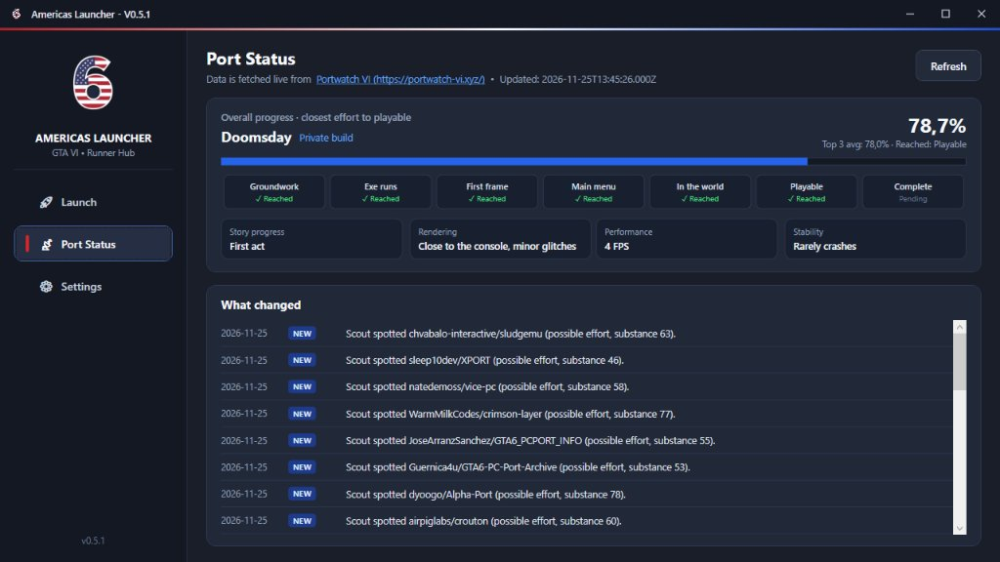

# Americas Launcher

A modern launcher that automatically sets up, updates, builds, and launches Xbox Series X|S (GDK) compatibility layers on Windows and Linux — with live port progress tracking built in. On Linux it ships as an AppImage and runs the runners through Wine or Proton (see [Linux](#linux-appimage)).

> This project is intended **only for games you legally own**, unpacked on your own PC. Americas Launcher does **not** include, download, or distribute games, keys, or console SDK files.


## Features

- **Modern 720p UI:** Clean dark navy & patriot-themed interface with custom window controls and 5 selectable runner cards.
- **One-Click Install / Update:**
  - Automatically checks and installs missing dependencies via `winget` (Git, Visual Studio C++ Build Tools, Rust).
  - Clones and updates each runner's source repository with `git`, then compiles it locally.
  - Displays the installed commit hash and checks upstream for updates.
- **Integrated Console Output:** Runner output and pre-launch shader/pipeline translation logs stream directly inside the launcher's log box — no separate CMD window pops up.
- **Pre-Launch Pipeline Support:** Runs `preLaunchArgs` (such as `translate --pipelines`) sequentially before starting the game, with a clear notice when first-time translation may take several minutes.
- **Settings & Self-Update Check:** Configure your Game Folder and Game Exe paths, and check GitHub Releases for newer versions of Americas Launcher.
- **Live Port Status:** Built-in tracker powered by [Portwatch VI](https://portwatch-vi.xyz/).

## Supported Runners

Runners are configured in [`src/AmericasLauncher/Data/runners.json`](src/AmericasLauncher/Data/runners.json). Click any of the 5 runner cards on the **Launch** screen to switch between them:

| Runner | Based On / Focus | Repository |
|---|---|---|
| **XCL** | Independent Xbox Series compatibility layer | [xcl-dev/xcl](https://github.com/xcl-dev/xcl) |
| **Belabug - VIctory Based** | VIctory fork tuned for AMD Radeon GPUs | [Belobug/VIctory-Belobug-AMD](https://github.com/Belobug/VIctory-Belobug-AMD) |
| **Dexnom - VIctory Based** | Community VIctory fork with D3D12 & shader fixes | [DexNom/VIctory](https://github.com/DexNom/VIctory) |
| **Zettrox - VIctory Based** | VIctory fork focused on NVIDIA GPUs & stability | [Zettrox/ztrx](https://github.com/Zettrox/ztrx) |
| **VIctory(Original)** | Original VIctory compatibility layer | [Marvisak/VIctory](https://github.com/Marvisak/VIctory) |

## Port Status

The **Port Status** tab fetches live data directly from **[Portwatch VI](https://portwatch-vi.xyz/)** ([`4lwayz/portwatch-vi`](https://github.com/4lwayz/portwatch-vi)):



- **Overall progress · closest effort to playable:** Shows the leading build, overall percentage score, top-3 average, milestone progress (`Groundwork` → `Exe runs` → `First frame` → `Main menu` → `In the world` → `Playable` → `Complete`), and the four quality tracks (`Story progress`, `Rendering`, `Performance`, `Stability`).
- **What changed:** Displays the latest tracked updates and newly discovered community efforts.

## Requirements

> Linux: see [Linux (AppImage)](#linux-appimage).

- Windows 10/11 (64-bit) with [winget](https://learn.microsoft.com/windows/package-manager/) (App Installer)
- A D3D12 GPU with Shader Model 6.6 and mesh shaders
- Several GB of free disk space and an internet connection for the first setup (Visual Studio Build Tools and Rust are large)
- [.NET 8 SDK](https://dotnet.microsoft.com/download) to build the launcher from source, or use a release build

## Building the Launcher

```powershell
git clone https://github.com/isaac-btw/AmericasLauncher.git
cd AmericasLauncher/src/AmericasLauncher
dotnet run
```

To create a release build:

```powershell
dotnet publish -c Release -r win-x64 --self-contained false -o publish
```

## Usage

1. Open **Settings** from the left sidebar and select your **Game Folder** and **Game Executable** (`Game.exe`).
2. Go to **Launch** and click the runner card you want to use.
3. Click **Install / Update** to install dependencies and build the runner. Watch the integrated log box at the bottom.
4. Click **Launch Game**. *(First-time shader/pipeline translation can take several minutes before the game window opens.)*

Launcher configuration and built runner sources are stored in `%LocalAppData%\AmericasLauncher\`.

## Adding a Runner

Add an entry to `src/AmericasLauncher/Data/runners.json`:

```json
{
  "id": "example",
  "name": "Example",
  "gitUrl": "https://github.com/owner/repo.git",
  "dependencies": [
    { "name": "Git", "wingetId": "Git.Git", "check": "command:git" }
  ],
  "buildCommands": [ "cargo build --release" ],
  "exe": "target\\release\\example.exe",
  "preLaunchArgs": [ "translate --pipelines \"{gameFolder}\\shaders.rpf\" \"{gameExe}\"" ],
  "launchArgs": "run \"{gameExe}\" --execute",
  "notes": "Optional text shown after a successful setup."
}
```

| Field | Description |
|---|---|
| `gitUrl` | Repository cloned into `%LocalAppData%\AmericasLauncher\sources\<id>` |
| `dependencies` | `winget` packages to install if missing (`command:<exe>` or `vsbuildtools`) |
| `buildCommands` | Commands run with `cmd.exe` inside the source folder |
| `exe` | Built executable, relative to the source folder |
| `preLaunchArgs` | Optional list of commands run sequentially before `launchArgs` |
| `launchArgs` | Arguments for the executable (`{gameFolder}` and `{gameExe}` are replaced automatically) |
| `linux` | Optional Linux recipe, see [Linux runner recipes](#linux-runner-recipes) |

## Linux (AppImage)

The Linux launcher (`src/AmericasLauncher.Linux`, built with [Avalonia](https://avaloniaui.net/)) has the same screens as the Windows one. The runners are Windows programs, so on Linux the launcher:

1. **cross-compiles** each runner for `x86_64-pc-windows-msvc` with [cargo-xwin](https://github.com/rust-cross/cargo-xwin) (it downloads the Microsoft C runtime and Windows SDK libraries into `~/.cache/cargo-xwin` on the first build);
2. **runs** it through **Wine** with [vkd3d-proton](https://github.com/HansKristian-Work/vkd3d-proton) installed into the launcher's Wine prefix (Direct3D 12 on Vulkan), or through **Proton** with [umu-launcher](https://github.com/Open-Wine-Components/umu-launcher);
3. puts the **DirectX Shader Compiler** (`dxcompiler.dll`, `dxil.dll`, from Microsoft's [DXC release](https://github.com/microsoft/DirectXShaderCompiler/releases)) next to runners that need it (XCL);
4. hands the game paths to the runner as Windows paths on drive `Z:` (`/home/me/Games/GTA VI` → `Z:\home\me\Games\GTA VI`).

### Linux requirements

- x86_64 CPU with AVX2, a Vulkan driver with mesh shader support (recent Mesa RADV, or NVIDIA's proprietary driver)
- Build tools and Wine from your distribution (Rust and cargo-xwin are installed automatically into `~/.cargo`, no root needed):

| Distribution | Command |
|---|---|
| Debian / Ubuntu | `sudo apt install git build-essential clang lld llvm wine64` |
| Fedora | `sudo dnf install git gcc clang lld llvm wine` |
| Arch / Manjaro / SteamOS (dev mode) | `sudo pacman -S --needed git base-devel clang lld llvm wine` |
| openSUSE | `sudo zypper install git gcc clang lld llvm wine` |

- **Proton instead of Wine (optional):** install `umu-launcher` (Arch, Fedora, or from its [releases](https://github.com/Open-Wine-Components/umu-launcher/releases)) and choose *Proton (umu-launcher)* in **Settings → Windows runtime**. By default umu downloads and updates GE-Proton itself; you can also point it to a Proton folder.
- **Settings → Check Requirements** lists what is found and prints the install command for your distribution.

### Using the AppImage

```bash
chmod +x AmericasLauncher-*-x86_64.AppImage
./AmericasLauncher-*-x86_64.AppImage
```

1. **Settings**: select the **Game Folder** and **Game Executable** (or paste their paths), and the **Windows runtime** (Wine binary, or Proton). A custom Wine build or Wine prefix can be set there too.
2. **Launch**: pick a runner card and click **Install / Update**. The first build takes a while (Rust toolchain, Windows libraries, then the runner itself); the Wine prefix and vkd3d-proton are set up at the end.
3. Click **Launch Game**. **Stop** ends the game and the Wine processes of the prefix.

Everything the launcher creates lives in `~/.local/share/AmericasLauncher/` (`config.json`, `launcher.log`, `sources/<runner>`, `prefix/`, `prefix-proton/`, `tools/`).

If the AppImage does not start because FUSE is missing, run it with `--appimage-extract-and-run`, or install your distribution's `fuse3` package.

### Building the Linux launcher

```bash
dotnet run --project src/AmericasLauncher.Linux          # run from source (.NET 8 SDK)
./packaging/linux/build-appimage.sh                      # → dist/AmericasLauncher-<version>-x86_64.AppImage
```

### Linux runner recipes

Each runner in `runners.json` has a `linux` object (runners without one are listed, but cannot be installed on Linux):

```json
"linux": {
  "dependencies": [ "git", "cc", "clang", "llvm-ml", "rust", "cargo-xwin" ],
  "buildCommands": [
    "rustup toolchain install || rustup show",
    "rustup component add llvm-tools",
    "cargo xwin build --release -p victory --target x86_64-pc-windows-msvc"
  ],
  "exe": "target/x86_64-pc-windows-msvc/release/victory.exe",
  "needsDxc": false
}
```

| Field | Description |
|---|---|
| `dependencies` | Checked before building: `git`, `cc`, `clang`, `llvm-ml` (for crates with MASM assembly, e.g. `blake3`) are system packages; `rust` (rustup) and `cargo-xwin` are installed automatically |
| `buildCommands` | Commands run with `bash` inside the source folder |
| `exe` | Built executable, relative to the source folder |
| `needsDxc` | Put `dxcompiler.dll` and `dxil.dll` next to the executable |

`preLaunchArgs` and `launchArgs` are shared with Windows.

### Linux troubleshooting

- **A build step fails with `llvm-ml` / `clang-cl` / `lld-link` not found**: install `clang`, `lld` and `llvm` (Debian and Ubuntu keep these tools in `/usr/lib/llvm-<version>/bin`, which the launcher adds to its `PATH`).
- **Nothing is drawn, or the runner reports no Direct3D 12 device**: check `vulkaninfo` for your GPU and mesh shader support, then **Settings → Prepare Runtime** to reinstall vkd3d-proton (Wine), or try Proton.
- **More Wine output**: start the AppImage with `WINEDEBUG=err+all` (the launcher hides Wine's messages by default). Extra `WINEDLLOVERRIDES` are kept.
- The full log of every session is in `~/.local/share/AmericasLauncher/launcher.log`.

## License

[GNU GPL v2](LICENSE) (`GPL-2.0-only`).

## Disclaimer

Americas Launcher is an independent open-source project and has **no affiliation, association, authorization, endorsement, or connection whatsoever with Grand Theft Auto (GTA), Rockstar Games, or Take-Two Interactive**. It is also not affiliated with the developers of XCL, VIctory, or Portwatch VI — those projects are developed separately under their own licenses. Use of pirated or leaked content is not supported.
